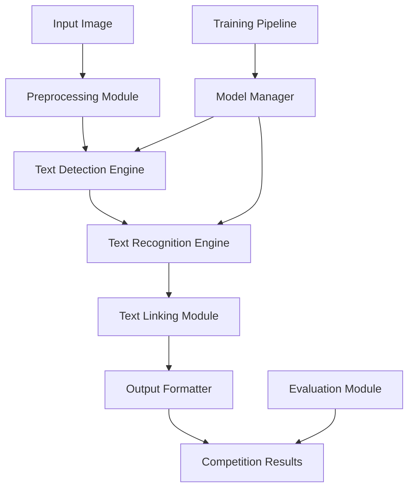

# Design Document

## Overview

The Historical Map Text Processing System is designed as a modular, deep learning-based pipeline that addresses the ICDAR 2025 competition requirements. The system follows a three-stage architecture: Detection → Recognition → Linking, with support for both word-level and phrase-level processing. The design emphasizes modularity, scalability, and competition-specific output formatting.

## Architecture



The system uses a microservices-inspired architecture with clear separation of concerns:

- **Preprocessing Module**: Image enhancement and normalization
- **Detection Engine**: CNN-based text region detection
- **Recognition Engine**: Transformer-based OCR with multi-language support
- **Linking Module**: Spatial association and coordinate mapping
- **Model Manager**: Handles model loading, versioning, and switching
- **Training Pipeline**: Supports model training and fine-tuning
- **Evaluation Module**: Comprehensive metrics and performance analysis

## Components and Interfaces

### 1. Core Processing Pipeline

**ImageProcessor**
```python
class ImageProcessor:
    def preprocess(self, image: np.ndarray) -> ProcessedImage
    def enhance_text_visibility(self, image: np.ndarray) -> np.ndarray
    def normalize_resolution(self, image: np.ndarray) -> np.ndarray
    def correct_orientation(self, image: np.ndarray) -> np.ndarray
```

**TextDetector**
```python
class TextDetector:
    def detect_words(self, image: ProcessedImage) -> List[WordDetection]
    def detect_phrases(self, image: ProcessedImage) -> List[PhraseDetection]
    def get_confidence_scores(self, detections: List[Detection]) -> List[float]
```

**TextRecognizer**
```python
class TextRecognizer:
    def recognize_words(self, detections: List[WordDetection]) -> List[RecognizedWord]
    def recognize_phrases(self, detections: List[PhraseDetection]) -> List[RecognizedPhrase]
    def handle_multilingual(self, text_region: np.ndarray) -> str
```

**TextLinker**
```python
class TextLinker:
    def link_to_coordinates(self, recognized_text: List[RecognizedText]) -> List[LinkedText]
    def group_related_text(self, linked_text: List[LinkedText]) -> List[TextGroup]
    def calculate_spatial_confidence(self, linkage: LinkedText) -> float
```

### 2. Model Management System

**ModelManager**
```python
class ModelManager:
    def load_detection_model(self, model_path: str) -> DetectionModel
    def load_recognition_model(self, model_path: str) -> RecognitionModel
    def switch_model_version(self, version: str) -> None
    def get_model_metadata(self) -> ModelMetadata
```

**TrainingPipeline**
```python
class TrainingPipeline:
    def train_detection_model(self, dataset: Dataset) -> DetectionModel
    def fine_tune_recognition_model(self, dataset: Dataset) -> RecognitionModel
    def evaluate_model_performance(self, model: Model, test_set: Dataset) -> Metrics
```

### 3. Competition Interface

**CompetitionFormatter**
```python
class CompetitionFormatter:
    def format_task1_output(self, detections: List[WordDetection]) -> str
    def format_task2_output(self, detections: List[PhraseDetection]) -> str
    def format_task3_output(self, results: List[RecognizedWord]) -> str
    def format_task4_output(self, results: List[RecognizedPhrase]) -> str
```

## Data Models

### Core Data Structures

```python
@dataclass
class BoundingBox:
    x: int
    y: int
    width: int
    height: int
    confidence: float

@dataclass
class Detection:
    bbox: BoundingBox
    detection_type: str  # 'word' or 'phrase'
    confidence: float
    image_coordinates: Tuple[int, int, int, int]

@dataclass
class RecognizedText:
    detection: Detection
    text: str
    language: str
    recognition_confidence: float
    character_confidences: List[float]

@dataclass
class LinkedText:
    recognized_text: RecognizedText
    map_coordinates: Tuple[float, float]
    spatial_confidence: float
    related_features: List[str]

@dataclass
class ProcessingResult:
    task_type: str
    detections: List[Detection]
    recognized_texts: List[RecognizedText]
    linked_texts: List[LinkedText]
    processing_time: float
    metrics: Dict[str, float]
```

### Model Configurations

```python
@dataclass
class DetectionConfig:
    model_architecture: str  # 'YOLO', 'RCNN', 'CRAFT'
    input_size: Tuple[int, int]
    confidence_threshold: float
    nms_threshold: float
    batch_size: int

@dataclass
class RecognitionConfig:
    model_architecture: str  # 'CRNN', 'TrOCR', 'PARSeq'
    max_sequence_length: int
    vocabulary_size: int
    languages: List[str]
    beam_width: int
```

## Error Handling

### Detection Errors
- **Low Confidence Detections**: Implement confidence thresholding with fallback to alternative detection methods
- **Overlapping Regions**: Use Non-Maximum Suppression (NMS) with adaptive thresholds
- **False Positives**: Employ post-processing filters based on text characteristics

### Recognition Errors
- **Character Recognition Failures**: Implement character-level confidence scoring with rejection thresholds
- **Language Detection Errors**: Use ensemble methods for multi-language text recognition
- **Historical Spelling Variations**: Maintain original text without auto-correction

### System Errors
- **Memory Management**: Implement batch processing with configurable memory limits
- **Model Loading Failures**: Provide graceful degradation to backup models
- **File I/O Errors**: Comprehensive error logging with retry mechanisms

```python
class ErrorHandler:
    def handle_detection_error(self, error: DetectionError) -> Optional[List[Detection]]
    def handle_recognition_error(self, error: RecognitionError) -> Optional[str]
    def handle_system_error(self, error: SystemError) -> None
    def log_error_metrics(self, error: Exception) -> None
```

## Testing Strategy

### Unit Testing
- **Component Isolation**: Test each module independently with mock dependencies
- **Model Interface Testing**: Verify model loading, inference, and output formatting
- **Data Validation**: Test input validation and data structure integrity

### Integration Testing
- **Pipeline Testing**: End-to-end testing with sample historical map images
- **Competition Format Testing**: Verify output compliance with ICDAR 2025 requirements
- **Performance Testing**: Measure processing speed and memory usage

### Model Testing
- **Accuracy Testing**: Evaluate detection and recognition accuracy on validation sets
- **Robustness Testing**: Test with various image qualities and degradation levels
- **Cross-Language Testing**: Validate performance on Latin and Chinese character sets

### Test Data Strategy
```python
class TestDataManager:
    def generate_synthetic_maps(self, count: int) -> List[SyntheticMap]
    def create_degradation_variants(self, base_image: np.ndarray) -> List[np.ndarray]
    def prepare_multilingual_samples(self) -> List[MultilingualSample]
    def validate_ground_truth(self, annotations: List[Annotation]) -> bool
```

### Evaluation Metrics
- **Detection Metrics**: Precision, Recall, F1-score, IoU-based evaluation
- **Recognition Metrics**: Character accuracy, word accuracy, BLEU score
- **Linking Metrics**: Spatial accuracy, coordinate precision
- **System Metrics**: Processing time, memory usage, throughput

### Continuous Integration
- **Automated Testing**: Run test suite on code changes
- **Model Validation**: Automatic model performance regression testing
- **Competition Compliance**: Verify output format compatibility
- **Performance Benchmarking**: Track system performance over time